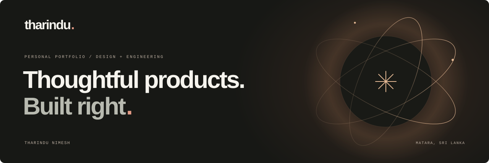
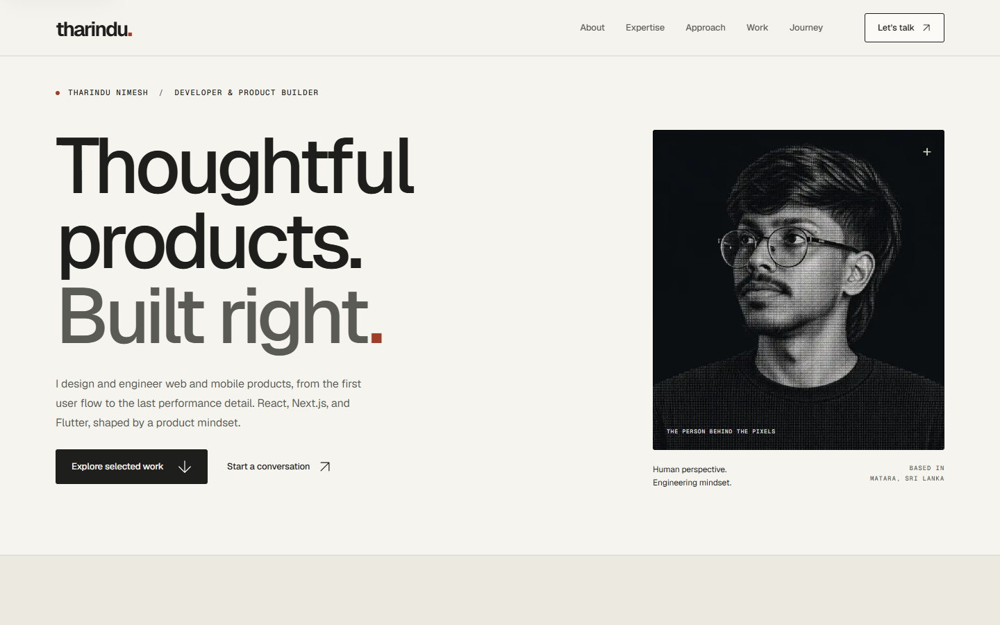

<p align="center">
  
</p>

<p align="center">
  A personal portfolio by <strong>Tharindu Nimesh</strong>.<br />
  Warm typography, considered interactions, and the stories behind the work.
</p>

<p align="center">
  
  
  
  
</p>

<p align="center">
  <a href="#the-experience">The experience</a> ·
  <a href="#run-locally">Run locally</a> ·
  <a href="#make-it-yours">Make it yours</a> ·
  <a href="#show-some-support">Leave a star</a>
</p>

---

## The experience

This is my space on the web: a collection of web and mobile projects, the decisions behind them, and the path I’m taking as a developer and product builder in Sri Lanka.

The visual language pairs warm ivory surfaces with charcoal type and terracotta accents. Large editorial headings give the work room to breathe; a darker, cinematic introduction brings a different energy to the first visit.



- **A personal entrance.** An eclipse glow and orbital light trails frame my portrait and name, then move them into the hero and navigation.
- **One introduction per tab session.** The intro appears before the page on a first visit and skips subsequent refreshes in that tab.
- **Stories behind the projects.** Dedicated case studies cover the problem, goal, process, solution, and outcome for Everlife Weddings, Go Surf Sri Lanka, and Internly.
- **A complete personal story.** About, expertise, approach, and journey sections connect the projects to the person building them.
- **Motion with room to breathe.** Section reveals, image movement, and desktop scrolling are paired with reduced-motion support and native touch scrolling.
- **A direct way to connect.** Email, copy-to-clipboard, GitHub, and LinkedIn keep the next step simple.

Core content and navigation remain available with JavaScript disabled. Internly’s authored device visual is labeled as an **interface study**; asset sources are recorded in [the asset notes](docs/ASSETS.md).

## Under the surface

| Layer         | Built with                                                                    |
| ------------- | ----------------------------------------------------------------------------- |
| Application   | Next.js App Router, React, TypeScript                                         |
| Visual system | Tailwind CSS, section stylesheets, Geist Sans and Geist Mono                  |
| Animation     | GSAP for the intro and imagery; Framer Motion for reveals and route entrances |
| Scrolling     | Lenis on supported desktop interactions, native scrolling on touch devices    |
| Checks        | ESLint, Prettier, TypeScript, Playwright, axe, Lighthouse                     |

The portfolio runs without environment variables, API keys, a database, or a contact-service backend. The contact action opens an email client.

## Run locally

Install Node.js and the pnpm version pinned in [`package.json`](package.json), then:

```bash
git clone https://github.com/tharinduxn/tharindunimesh.com.git tharindunimesh
cd tharindunimesh
pnpm install
pnpm dev
```

Open [localhost:3000](http://localhost:3000).

For a production build:

```bash
pnpm build
pnpm start
```

## Make it yours

If this gives you an idea for your own portfolio, start with the story you want to tell: who you are, what you have built, and how you approach a problem. These are the places to explore:

| Change                                    | Start here                                                                                                   |
| ----------------------------------------- | ------------------------------------------------------------------------------------------------------------ |
| Page sections and their order             | [`app/page.tsx`](app/page.tsx)                                                                               |
| Colors, typography, and spacing           | [`app/globals.css`](app/globals.css)                                                                         |
| Individual section styling                | [`app/styles/`](app/styles/)                                                                                 |
| Portrait, introduction, and personal copy | [`components/hero.tsx`](components/hero.tsx), [`components/about.tsx`](components/about.tsx)                 |
| Intro choreography and appearance         | [`components/intro-loader.tsx`](components/intro-loader.tsx), [`app/styles/intro.css`](app/styles/intro.css) |
| First-paint intro gate and metadata       | [`app/layout.tsx`](app/layout.tsx)                                                                           |
| Projects and case-study content           | [`lib/projects.ts`](lib/projects.ts)                                                                         |
| Case-study page structure                 | [`app/work/[slug]/page.tsx`](app/work/%5Bslug%5D/page.tsx)                                                   |
| Portrait and project images               | [`public/images/`](public/images/)                                                                           |
| Contact details and social links          | [`components/contact.tsx`](components/contact.tsx), [`components/footer.tsx`](components/footer.tsx)         |

For your own portfolio, use your own writing, portrait, and project imagery. See [asset sources](docs/ASSETS.md) for the original materials.

<details>
<summary><strong>Development commands and project notes</strong></summary>

Run browser checks with a local server running. They use an installed Chrome browser by default; set `QA_BROWSER=msedge` to use Edge.

| Command                  | Purpose                                                           |
| ------------------------ | ----------------------------------------------------------------- |
| `pnpm typecheck`         | Generate route types and check TypeScript                         |
| `pnpm lint`              | Check source with ESLint                                          |
| `pnpm format:check`      | Check formatting                                                  |
| `pnpm format`            | Format maintained source and documentation                        |
| `pnpm test:browser`      | Check responsive layouts, images, anchors, and accessibility      |
| `pnpm test:interactions` | Check keyboard navigation, menus, and clipboard feedback          |
| `pnpm test:motion`       | Check motion behavior, navigation, and content without JavaScript |
| `pnpm audit:lighthouse`  | Generate local performance and accessibility reports              |

Browser checks use `http://127.0.0.1:3000` by default. Set `QA_URL` to target another local preview. Screenshots and reports are written to the ignored `.qa/` directory. Run Lighthouse separately from other resource-intensive checks.

Read the [design blueprint](docs/REDESIGN.md), [dated validation record](docs/VALIDATION.md), and [asset notes](docs/ASSETS.md) for the decisions and evidence behind the build.

</details>

## Show some support

If this portfolio inspired an idea or helped you with your own build, **[give the repository a star](https://github.com/tharinduxn/tharindunimesh.com)**. It’s a small way to support the work and help others discover it.

Found a rough edge or have a thoughtful suggestion? [Open an issue](https://github.com/tharinduxn/tharindunimesh.com/issues). I’d love to see what you create, too.

---

<p align="center">
  Built with care by <a href="https://github.com/tharinduxn"><strong>Tharindu Nimesh</strong></a> · Matara, Sri Lanka<br />
  <a href="mailto:tharinduxn@gmail.com">Email</a> · <a href="https://linkedin.com/in/tharinduxn">LinkedIn</a> · <a href="https://github.com/tharinduxn">GitHub</a>
</p>
